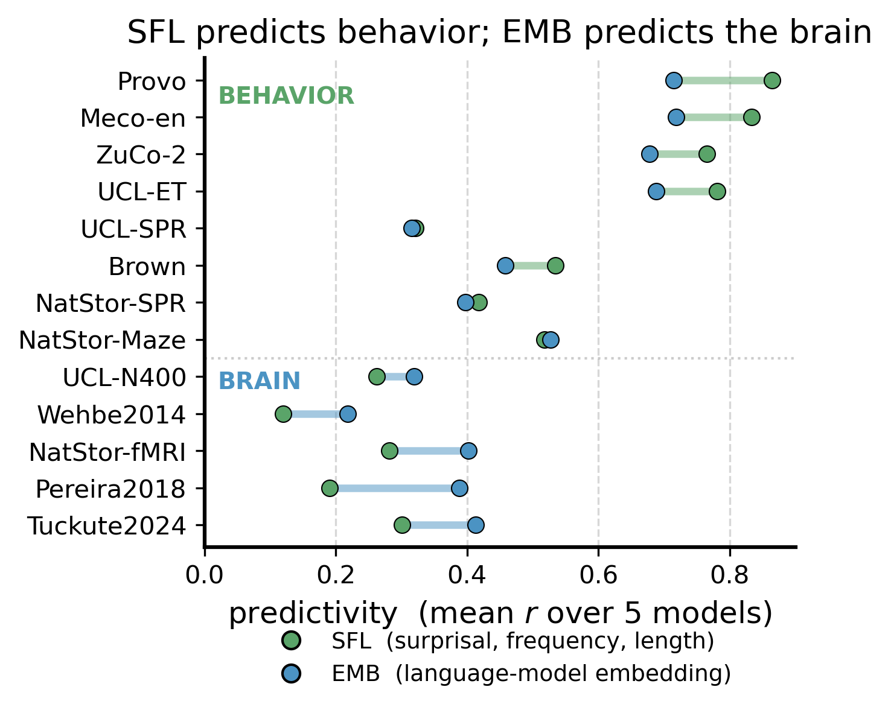
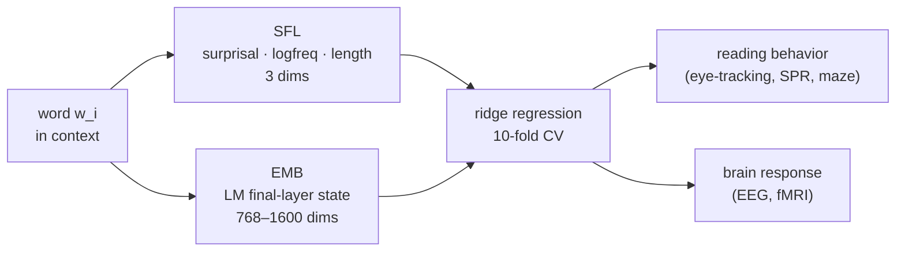
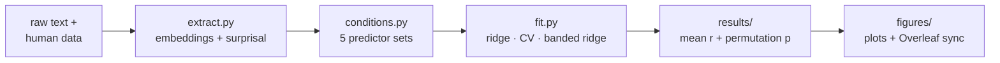

# SFL-EMB

### Behavioral and brain responses to language reflect different levels of linguistic representation

Code and data for **de Varda, Berzak, Fedorenko & Levy**. A single analytic framework
for asking a question that behavioral and neural language research usually answer
separately: **do reading behavior and brain activity encode the same information?**

<p align="center">
  
</p>

We compare two families of per-word predictors, both derived from the *same* language
model, across **8 behavioral and 5 neural datasets**:

- 🟢 **SFL** — three interpretable scalars per word: **s**urprisal, log-**f**requency,
  word **l**ength. The classic "effort" account of processing difficulty.
- 🔵 **EMB** — the model's final-layer embedding for the word (768–1600 dims): rich,
  contextual, meaning-bearing representation.

> **Take-home.** SFL predicts **reading behavior** better; EMB predicts **brain
> responses** better. Behavior looks like a *compressed, effort-based readout* of
> language processing, while the brain retains far more of the high-dimensional
> representational content. The dissociation holds even on the *same sentences* read
> under both modalities (the UCL and NatStories corpora), so it reflects the measures
> themselves, not the stimuli.

Because every dataset runs through one identical pipeline — same models, same ridge
estimator, same cross-validation and significance test — this repo is also a general
tool for **putting behavioral and neural evidence on the same footing** and asking
which representations each modality is sensitive to.

---

## What the pipeline does



Each dataset is fit under **five predictor conditions**, so we can read off both
absolute predictivity and what each predictor adds over the other:

| condition | predictor | asks |
|---|---|---|
| `sfl` | surprisal, log-freq, length | how far do 3 effort features go? |
| `emb` | LM embedding (D dims) | how far does the full representation go? |
| `all` | `sfl` ⌢ `emb` | does EMB add anything over SFL? |
| `sfl_rff` | SFL → D random Fourier features | is EMB's edge just dimensionality? |
| `sfl_rff_emb` | `sfl_rff` ⌢ `emb` | does EMB add over a dimensionality-matched SFL? |

---

## Datasets (13)

Curated from published resources; a subset (UCL, NatStories) has **both** behavioral
and neural recordings on the same sentences. `N` is the number of data points
(words / TRs / sentences) after preprocessing; reliability is split-half.

| | Dataset | Measure | Modality | Unit | N | Split-half *r* | Driver |
|---|---|---|---|--:|--:|--:|---|
| 🟢 | **Provo** | Eye-tracking | reading | word | 2,659 | 0.93 | `probe_Provo.py` |
| 🟢 | **Meco-en** | Eye-tracking | reading | word | 2,096 | 0.87 | `probe_meco.py` |
| 🟢 | **ZuCo-2** | Eye-tracking | reading | word | 6,461 | 0.76 | `probe_zuco.py` |
| 🟢 | **UCL-ET** | Eye-tracking | reading | word | 1,726 | 0.84 | `probe_ucl_et.py` |
| 🟢 | **UCL-SPR** | Self-paced reading | reading | word | 1,316 | 0.22 | `probe_ucl_spr.py` |
| 🟢 | **Brown** | Self-paced reading | reading | word | 5,862 | 0.39 | `probe_brown.py` |
| 🟢 | **NatStor-SPR** | Self-paced reading | reading | word | 8,779 | 0.70 | `probe_natstor_spr.py` |
| 🟢 | **NatStor-Maze** | Maze | reading | word | 9,779 | 0.47 | `probe_maze.py` |
| 🔵 | **UCL-N400** | ERP (N400) | EEG | word | 1,505 | 0.22 | `probe_ucl_n400.py` |
| 🔵 | **Wehbe2014** | BOLD | fMRI (visual) | TR | 1,211 | 0.16 | `probe_wehbe.py` |
| 🔵 | **NatStor-fMRI** | BOLD | fMRI (auditory) | TR | 1,516 | 0.61 | `probe_natstor_fmri.py` |
| 🔵 | **Pereira2018** | BOLD | fMRI (visual) | sentence | 627 | 0.28 | `probe_pereira.py` |
| 🔵 | **Tuckute2024** | BOLD | fMRI (visual) | sentence | 2,000 | 0.22 | `probe_tuckute.py` |

See `paper/PAPER_SUMMARY.md` for citations and per-dataset preprocessing.

---

## Quick start

```bash
conda env create -f environment.yml
conda activate sfl-emb

# one dataset, one model (fast smoke test)
SFL_MODELS=gpt2_small python probe_pereira.py

# one dataset, all five models
python probe_pereira.py

# everything: 13 datasets × 5 models × 5 conditions
bash cluster/run_all.sh
```

Two environment variables control every entry point:

- **`SFL_MODELS`** — comma-separated subset of
  `gpt,gpt2_small,gpt2_medium,gpt2_large,gpt2_xl` (default: all five).
- **`SFL_BACKEND`** — `himalaya` (GPU ridge, default) or `sklearn` (CPU). The two
  agree to ~1e-4, so you can develop on CPU and scale up on a GPU.

Results land in `results/<dataset>_<target>_results.csv`: one row per model, columns
for each condition's mean *r* and SD plus permutation *p*-values.

---

## How it works

**Models.** Five GPT variants (`openai-gpt`, `gpt2`, `gpt2-medium`, `gpt2-large`,
`gpt2-xl`); the same model supplies both surprisal and embeddings within an analysis,
recomputed from raw text on every run (cached under `cache/`, git-ignored). No
precomputed activations are stored.

**Predictors.**

- Embeddings are **mean-pooled** over a word's sub-word tokens (and over words for
  sentence/TR units); surprisal is **summed** over sub-words; frequency and length are
  word-level.
- Self-paced-reading datasets add **spillover** (words *i*, *i*−1, *i*−2 concatenated);
  eye-tracking and maze use word *i* only.
- TR-level fMRI pools per-word predictors into 2 s TRs and concatenates four lagged TR
  blocks for the hemodynamic delay.
- `sfl_rff` projects SFL into `D` random Fourier features (RBF-kernel approximation,
  median-heuristic bandwidth), fit on the training fold only — a leakage-safe,
  dimensionality-matched control for EMB.

**Fitting** (`src/fit.py`). Ridge regression, 10-fold cross-validation, α chosen per
fold by inner 5-fold CV. Predictors and responses are standardized within each
training fold. Two cross-validation schemes protect against leakage across the units
that share structure: **Pereira2018** holds out whole passages (`GroupKFold`), and
**NatStor-fMRI** holds out whole stories (leave-one-story-out, 9 folds); everything
else is sequential 10-fold. The `all` and `sfl_rff_emb` concatenations use **banded
ridge** (a separate penalty per feature block) so that combining predictors can never
score below the better block alone.

**Significance** (`src/significance.py`). A paired permutation test on the per-fold *r*
values — all 2ⁿ sign-flips of the paired fold differences.



---

## Repository layout

```
src/                importable pipeline package
  extract.py          transformers embeddings + surprisal (sub-word aligned)
  fit.py              ridge encoding, cross-validation, banded ridge
  rff.py              random-Fourier-feature SFL expansion + word/TR pooling
  conditions.py       the 5-condition runner
  significance.py     paired permutation test on fold-level r
  behavioral.py       word-level & spillover drivers (eye-tracking, SPR, maze, EEG)
  brain.py            sentence-level & TR-level drivers (fMRI)
  decompose.py        surprisal / frequency / length decomposition
  models.py           the 5 models (dims, last layer, tokenizer separators)
  prep/               one-off data prep (passage labels, Whisper timings, TR series)

probe_*.py            one driver per dataset (13); reads data/, writes results/
appendix/            supplementary analyses (layer sweep, reliability, RFF controls)
check-features/      what SFL_RFF vs EMB encode (meaning vs surface form)
figures/             plotting, Overleaf figure sync, numeric-audit scripts
cluster/             SLURM scripts + environment setup for MIT Engaging
data/                all curated input data
results/             fitted outputs (CSV summaries + per-fold predictions)
docs/                README assets
```

`data/` holds every input: the behavioral corpora, `subtlex.xlsx`, sentence lists, and
the brain datasets under `data/{pereira,tuckute,natstor_fmri,wehbe}/`. Large raw
arrays (fMRI subject `.npy`, audio, the Tuckute response table) are `.gitignore`d —
keep them backed up externally.

---

## Beyond the main comparison

- **Layer analysis** (`appendix/layerwise_logitlens.py`, `layerwise_significance.py`,
  `layerwise_plot.py`) — EMB predictivity at every layer vs SFL, per dataset. Heavy;
  run on the cluster (`cluster/slurm_layerwise.sh`).
- **SFL decomposition** (`src/decompose.py`) — surprisal / frequency / length taken
  individually and in every subset.
- **Reliability** (`appendix/reliability_and_size.py`) — split-half reliability of each
  dataset as a function of sample size.
- **Dimensionality & meaning controls** (`appendix/pereira_length_control.py`,
  `check-features/`) — is EMB's advantage about dimensionality, or content? What do the
  predictors actually encode (surface form vs meaning)?

---

## Reproducing the figures

The manuscript lives in a separate LaTeX project; the scripts here generate its assets:

- `figures/plot_results.py` — per-dataset bar figures, SFL_RFF variants, SFL
  decomposition, model-size boxplots.
- `figures/sync_to_overleaf.py` — copies every figure into the Overleaf tree with a
  checksum audit (no referenced image missing, no stale mapping).
- `figures/verify_paper_numbers.py` — re-derives every fitted number in the manuscript
  from `results/` and checks it against the LaTeX source.
- `docs/make_hero.py` — the summary figure at the top of this README.

---

## Running on the cluster (MIT Engaging)

```bash
sbatch cluster/slurm_engaging.sh            # all datasets, single GPU
sbatch cluster/slurm_engaging_array.sh      # 3 GPUs in parallel (job array)
sbatch cluster/slurm_layerwise.sh           # layer analysis (4-GPU array)
```

The array scripts partition datasets into cost-balanced buckets (one GPU each,
per-task logs, per-dataset outputs, so re-submitting resumes rather than recomputes).
A `flock`-guarded warmup installs dependencies and downloads the five models once.
Details in `cluster/ENGAGING.md`.
